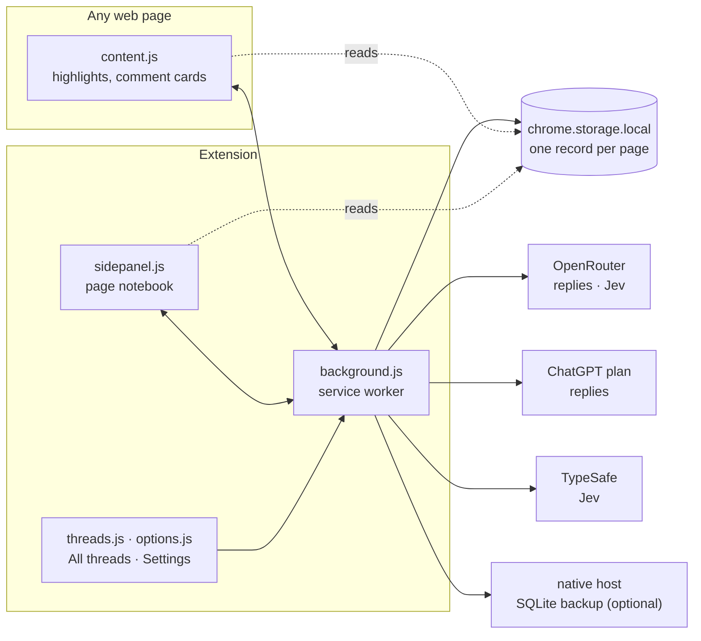

# How Margin works

Margin is a Chrome extension (Manifest V3, plain JavaScript, no build step). Everything runs in the browser: notes live in Chrome's extension storage, and the only network calls are to the model provider the user signs in to.



## Pieces

| File | What it does |
|---|---|
| `content.js` | Runs on every http(s) page. Shows the comment box on a selection, paints saved highlights, draws margin icons and comment cards inside one closed shadow root, and streams replies into the open card. |
| `anchor.js` | Finds a saved passage again on a later visit (text quote + prefix/suffix, with a position hint). Reads the DOM, never changes it. |
| `background.js` | The service worker. The only writer to storage. Builds prompts, calls the model, tags threads, finds related threads, and handles sign-in. |
| `providers.js` | Model calls: OpenRouter Chat Completions and the ChatGPT plan's Responses API (both streamed), Jev scoring, OpenRouter sign-in. |
| `chatgpt.js` | Sign in with ChatGPT (OAuth with PKCE) and token refresh. Tokens live in the extension's own IndexedDB. |
| `thread-index.js` | Builds a search index over stored threads and shortlists related ones by shared tags and word overlap. |
| `retrieval.js` | Scores the shortlist with Jev, picks up to three, and formats them for the prompt. |
| `graph.js` | Tag parsing and merging, the tag vocabulary, and the links shown on the All threads graph. |
| `sidepanel.js` | The page notebook: gist, what you learned, still open, and questions about the whole page. |
| `threads.js` | All threads: every thread on every page, as a list or a graph, with search. |
| `options.js` | Settings: model, related threads, excluded sites, export and delete. |
| `notes.js`, `settings.js`, `url.js` | Copy-as-notes Markdown with `#:~:text=` links; excluded sites; URL normalisation. |
| `native-host/` | Optional Python host that copies every page record to a local SQLite file. |
| `vendor/` | Readability (article text), marked (Markdown), DOMPurify (sanitising replies). |

## Asking about a passage

1. You select text. `content.js` shows a comment box beside it.
2. You send a question (or a quick action like Explain). `content.js` sends `highlight.create` and `thread.send` to the service worker; the highlight is saved with its passage, surrounding paragraph and anchor.
3. On a thread's first question, a small model call tags it with 3–5 concepts (one or two specific names, then broader subjects), reusing tags already in use.
4. The service worker shortlists threads from other pages that share a tag (`findCandidates`), and Jev scores how much each would help with this question. Up to three that score high enough are added to the prompt as `<related_threads>`.
5. The prompt is the page title, the page summary if there is one, your notes on the page, the passage and its paragraph, the thread so far, and the related threads. The full article isn't sent with questions. If the model needs more of the page it says so, and the card offers **Share page and retry**, which summarises the page and asks again. The reply streams back through `chrome.storage.session` into the card.
6. The reply is saved with the identities of the related threads it was given and any `[R1]`-style citations, which the card turns into links. If the reply named a new topic, its tags are added to the thread.

Resolving a thread drafts a one-line takeaway, which you accept or edit. Summarise, in the side panel, is the one call that sends the article: Readability extracts it from the live page, and the summary it writes goes with every later question on that page. Asking about the whole page summarises it first if needed.

## Storage

**`chrome.storage.local`**

- `page:<urlKey>`: one record per article. `urlKey` is the normalised URL (lowercase host, no fragment, no tracking parameters, no trailing slash; the canonical link when it's on the same site).
  - `title`, `updatedAt`
  - `summary`: `{text, createdAt, contentHash}`
  - `article`: the article as extracted at the first summary
  - `qa`: the thread about the whole page
  - `highlights[]`: `id`, `exact`, `prefix`, `suffix`, `start`, `end`, `context`, `status` (open or resolved), `takeaway`, `concepts` (tags), `createdAt`, and `messages[]`
  - each message: `role` (user, assistant or note), `content`, `ts`, and for replies `by` (the model), `related`, `refs`
- `settings`: provider and models, the OpenRouter key, the TypeSafe key, who runs Jev, excluded sites.

**`chrome.storage.session`**: in-flight state only. Which page a tab shows, which thread is open, pending and streaming replies, the retrieval phase, and sign-in attempts in progress.

**IndexedDB** (extension origin): ChatGPT sign-in tokens, out of reach of content scripts.

Only the service worker writes page records, one write at a time per page, so two tabs on the same article can't overwrite each other.

## Messages

Pages talk to the service worker with `chrome.runtime.sendMessage({type, ...})`. The worker only accepts messages from Margin itself.

| Type | What it does |
|---|---|
| `page.load`, `page.anchored` | Load a page's highlights; report which ones couldn't be found again |
| `highlight.create`, `highlight.open`, `highlight.delete` | Save, open or delete a highlight |
| `thread.send` | Ask, add a note, or retry (`id: "page"` for the page thread) |
| `thread.resolve`, `thread.reopen` | Draft or save a takeaway; reopen |
| `thread.connections` | Related threads for a card |
| `page.summarise`, `page.changed` | Summarise; check whether the page changed since |
| `page.delete`, `data.deleteAll` | Delete one page or everything |
| `provider.check`, `judge.check` | Test the reply model or Jev from Settings |
| `openrouter.signin`, `chatgpt.signin`, `chatgpt.signout`, `chatgpt.models` | Sign-in and model list |

## Models

- **OpenRouter**: any OpenRouter model with the user's key, from one-click sign-in or pasted. Defaults to `openrouter/free`. Requests carry `HTTP-Referer` and `X-Title: Margin`.
- **ChatGPT**: the user's ChatGPT plan (Go, Plus or Pro) through Sign in with ChatGPT.
- Each provider has a main model (replies, summaries) and a small one (tags, takeaways).
- **Jev** (TypeSafe) scores related threads, through the OpenRouter key or a TypeSafe key. Without either, the shortlist's top three are used.

Sign-in tabs return to a loopback address (`127.0.0.1` for ChatGPT, `localhost` for OpenRouter) that nothing listens on. The service worker sees the tab head there, reads the code from the URL, closes the tab and finishes sign-in.

## Security

- Page text, passages and earlier replies are marked as untrusted in every prompt, and models get no tools.
- Replies are rendered as Markdown through DOMPurify, inside a closed shadow root on pages.
- The service worker ignores messages from anything but Margin, and there's no `externally_connectable`.
- On excluded sites (banking and mail by default) Margin does nothing at all.
- API keys are in `chrome.storage.local`. Chrome lets content scripts read that, so set a spend limit on keys you give Margin. ChatGPT tokens are in IndexedDB instead.

More detail: [related-threads.md](related-threads.md) (tagging, shortlist, scoring) and [privacy.md](privacy.md) (what is sent where).

## Tests

```sh
for t in test/*.test.mjs; do node "$t" || exit; done   # unit tests (node:assert, Chrome APIs stubbed)
test/run-anchor.sh                                     # anchoring fixtures
python3 native-host/test_mirror.py                     # SQLite backup
```

Browser smoke tests: serve the repo with `python3 -m http.server 8000 --bind 127.0.0.1` and open `test/export-browser.test.html` or `test/retrieval-browser.test.html`. `test/eval-related.mjs` and `test/eval-tags.mjs` call real models and spend credits; usage is in each file's header.
